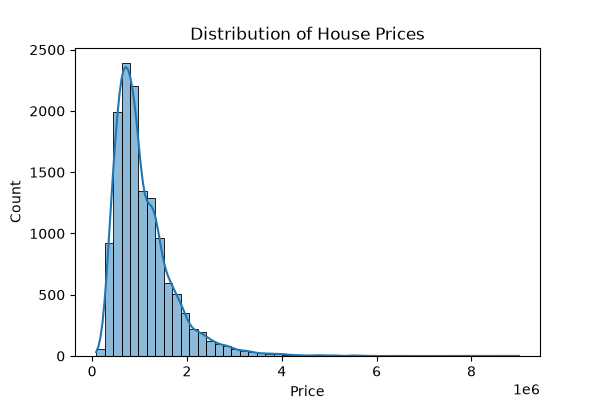
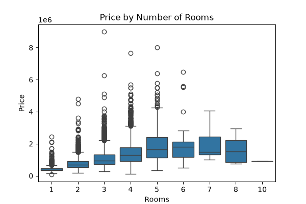
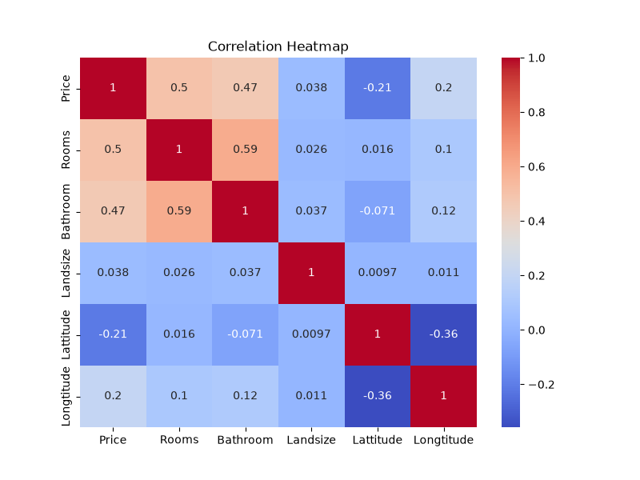

# 🏡 Melbourne Housing Price Prediction

A beginner-to-intermediate machine learning project predicting house prices in Melbourne using Python and scikit-learn.  
The project demonstrates **data cleaning, exploratory data analysis (EDA), feature engineering, preprocessing with pipelines, model training, hyperparameter tuning, and evaluation**.

---

## 📂 Dataset
- **Source:** [Kaggle – Melbourne Housing Snapshot](https://www.kaggle.com/datasets/dansbecker/melbourne-housing-snapshot)
- **Rows:** ~13,000
- **Target:** `Price`
- **Features include:**
  - `Rooms`, `Bathroom`, `Car`, `Landsize`, `BuildingArea`, `YearBuilt`
  - `Type`, `Regionname`, `Distance`, `Suburb`
  - Geographic coordinates (`Lattitude`, `Longtitude`)
  - Sale details (`Date`, `Method`, `SellerG`)

---

## 🛠️ Steps in the Notebook
1. **Load and clean data**
   - Drop rows missing `Price`
   - Inspect missing values in predictors
2. **Exploratory Data Analysis**
   - Histogram of `Price`
   - Boxplot: `Price` vs `Rooms`
   - Correlation heatmap
   - Distribution of `Landsize` (skewed, many outliers)
3. **Feature selection**
   - Numeric: `Rooms`, `Bathroom`, `Landsize`, `BuildingArea`, `YearBuilt`, `Lattitude`, `Longtitude`
   - Categorical: `Type`, `Regionname`
4. **Preprocessing**
   - Numeric → median imputation
   - Categorical → most frequent imputation + one-hot encoding
   - Combined via `ColumnTransformer`
5. **Model training**
   - **Decision Tree Regressor** (baseline, depth-limited)
   - **Random Forest Regressor** (with GridSearchCV for tuning)
6. **Evaluation**
   - Metrics: Mean Absolute Error (MAE), RMSE, R²
   - Compare Decision Tree vs Random Forest
7. **Predictions**
   - Predict on validation set
   - Predict for new example houses

---

## 📊 Example EDA Plots
*(replace with your own generated images in `/plots` folder)*

- Price distribution  
    

- Price vs Rooms  
    

- Correlation heatmap  
    

---

## 🧪 Results (sample numbers)
| Model                | MAE (k$) | RMSE (k$) | R²   |
|-----------------------|----------|-----------|------|
| Decision Tree (depth=10) | 260.4    | 380.2     | 0.61 |
| Random Forest (tuned) | 215.7    | 320.5     | 0.74 |

*(values vary run to run)*

---

## 🚀 Improvements & Next Steps
- Log-transform target (`Price`) to handle skew
- Add suburb-level median price as a feature
- Try advanced models (XGBoost, LightGBM)
- Explain predictions with SHAP or permutation importance
- Deploy with **Streamlit** or **FastAPI**

---

## ⚙️ How to Run
```bash
git clone <this-repo>
cd melbourne-housing
pip install -r requirements.txt
jupyter notebook notebook.ipynb
